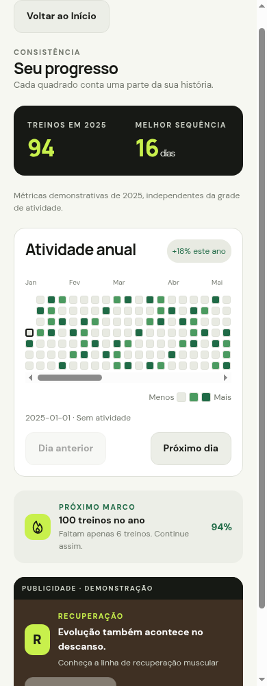
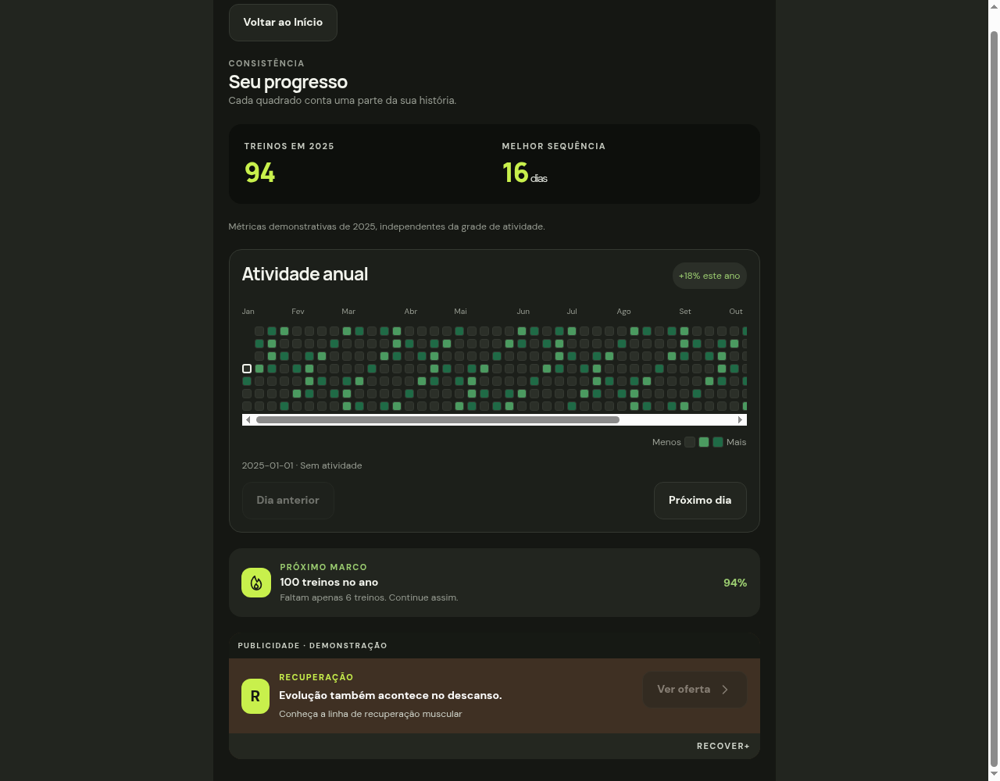

# Progresso — T3.4

O botão “Ver progresso” no Início abre `/progress`. A tela compõe ProgressHero,
ActivityCard, ActivityHeatmap, MilestoneCard e AdBanner da fase 2, usando os temas
existentes e conteúdo rolável centralizado em até 720 pontos.

Os dados são ilustrativos e fixos: 94 treinos em 2025, melhor sequência de 16 dias,
tendência de +18% e marco de 100 treinos, com 6 restantes e 94% de progresso.
Essas métricas não são calculadas a partir da grade nem de treinos executados.

Conforme decisão da pessoa usuária, manter a escala da T2.5: sem atividade,
1 atividade e 2 ou mais atividades. A referência web usa cinco níveis; o app
agrupa os níveis superiores. A grade usa 364 dias determinísticos de 2025,
com legenda, rótulos acessíveis, seleção de dia e navegação anterior/próximo.

ProgressScreen aceita `accountStatus?: AccountStatus`, com padrão `logged-out`.
`free` e `logged-out` exibem o banner demonstrativo RECOVER+; `premium` o oculta.
A rota usa o padrão enquanto o estado compartilhado de conta não é implementado
na T3.5. A integração das abas pertence à T3.7. Nenhuma publicidade real,
autenticação ou persistência foi adicionada.

## Conferência manual

1. No Início, selecionar “Ver progresso”, conferir métricas, tendência e marco;
   selecionar “Voltar ao Início”. Abrir `/progress` diretamente e repetir o retorno.
2. Na grade, consultar 1 de janeiro (sem atividade) e avançar para 2 de janeiro
   (2 ou mais atividades); voltar ao dia anterior. Rolar horizontalmente até dezembro.
3. Repetir em 320, 390, 720 e 1280 pontos e nos dois temas, incluindo rolagem até
   o banner. A página não deve ter overflow horizontal; a grade possui rolagem própria.
4. Na integração da T3.5, passar o estado de conta à tela e conferir que apenas
   Premium oculta o banner, inclusive ao trocar de tema.
5. Em iOS e Android, repetir com áreas seguras, fonte ampliada e leitor de tela.

## Registro — 2026-11-13

- `npm run lint` e `npx tsc --noEmit`: passaram.
- `node --test scripts/*.test.cjs`: testes existentes de atividade e dados de treino passaram.
- `npx expo export --platform all --output-dir /tmp/nerd-gym-t34-export`:
  bundles iOS, Android e web exportados.
- Chrome headless: métricas, 364 dias em 2025, três rótulos de níveis, consulta
  anterior/próximo, ações com altura mínima de 48 px, quatro larguras e dois temas,
  sem overflow horizontal da página nem exceções JavaScript.
- Fluxos Início → Progresso → Início e acesso direto com retorno seguro: passaram.
- Mudanças de `accountStatus` entre logged-out, Free e Premium verificadas por
  uma rota temporária que renderizou a tela real e alterou suas propriedades;
  a rota foi removida após a verificação. Roteiro: `/tmp/nerd-gym-t34-browser.cjs`.
- Capturas dos dois temas conferidas visualmente.
- Revisão independente do código e da documentação: sem achados acionáveis.
- Execução em dispositivos iOS/Android, fonte ampliada e leitor de tela: pendente.
  Nenhum dispositivo Android conectado estava disponível; exportar bundles não
  substitui verificação em dispositivo.

