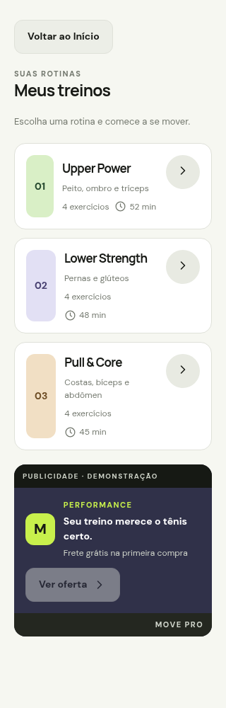
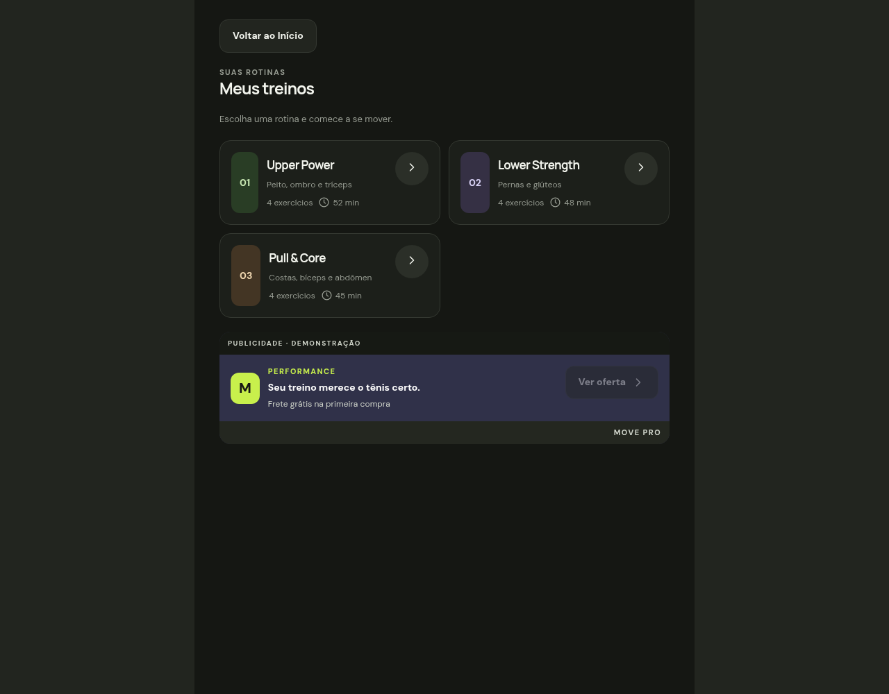

# Treinos — T3.2

O botão “Meus treinos” no Início abre `/workouts`. A tela reutiliza os cartões e o banner demonstrativo da fase 2 e apresenta Upper Power (52 min), Lower Strength (48 min) e Pull & Core (45 min), com foco e quatro exercícios cada. Os dados ficam em `src/data/demo-workouts.ts`, compartilhados com Início e a entrada de treino.

A ação “Iniciar [nome da rotina]” abre `/workout/1`, `/workout/2` ou `/workout/3`, com o primeiro exercício e a prescrição correspondentes. Fechar retorna à listagem quando o treino foi aberto por ela. Acesso direto à sessão mantém o retorno seguro a Início; IDs desconhecidos redirecionam para `/`.

A lista tem uma coluna abaixo de 650 pontos e duas a partir dessa largura, com conteúdo centralizado em até 720 pontos. Os índices alternam três pares de cores definidos no tema, com variantes claras e escuras.

Criação, avanço/finalização e abas completas permanecem nas T3.3, T3.6 e T3.7. Nenhum dado é persistido.

## Conferência manual

1. Abrir Início e selecionar “Meus treinos”. Conferir nomes, focos, duração, contagem e banner demonstrativo.
2. Iniciar cada rotina e conferir nome, primeiro exercício e prescrição: Supino reto (4 × 8–10), Agachamento livre (4 × 6–8) e Puxada alta (4 × 8–10).
3. Fechar cada sessão e conferir o retorno à lista. Selecionar “Voltar ao Início”.
4. Acessar `/workouts` diretamente; iniciar/fechar uma rotina e voltar a Início. Acessar `/workout/999` e conferir redirecionamento.
5. Repetir em 320, 390, 650, 720 e 1280 pontos, nos temas claro e escuro: nenhuma ação deve ficar truncada, e o conteúdo deve permitir rolagem vertical.
6. Em iOS e Android, repetir em dispositivos, incluindo áreas seguras, botão/gesto Voltar, fonte ampliada e leitor de tela.

## Registro — 2026-11-13

- `npm run lint` e `npx tsc --noEmit`: passaram.
- `node scripts/demo-workouts.test.cjs`: passou; compara todos os dados com `initialWorkouts` da referência atual.
- `node scripts/activity.test.cjs`: três testes passaram.
- `npx expo export --platform all --output-dir /tmp/nerd-gym-t32-export`: bundles iOS, Android e web exportados com sucesso. Isso não substitui execução em dispositivos.
- Chrome headless: larguras de 320, 390, 650, 720 e 1280 px sem overflow horizontal, ações de 48 px preservadas e mudança para duas colunas em 650 px.
- Fluxo Início → listagem; seleção/fechamento das três rotinas; retorno a Início e ID inválido: passaram, sem exceções JavaScript.
- Capturas dos temas claro e escuro conferidas visualmente. Roteiro da sessão: `/tmp/nerd-gym-t32-browser.cjs`.
- Revisão independente de código: sem achados.
- Validação em dispositivos iOS/Android, fonte ampliada e leitor de tela: pendente.

